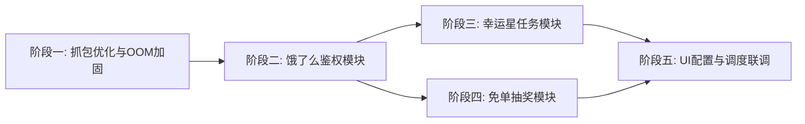

# 饿了么「幸运星」与「免单」开发实施计划

> **项目目标**: 在 Sesame-TK 模块中集成饿了么「幸运星」自动做任务/领奖及「免单」抽免单/领红包功能，并对底层抓包功能进行 OOM 安全加固与精简化改造。  
> **制定日期**: 2026-11-07  
> **关联文档**:
> * [《饿了么_幸运星与免单_总体分析报告.md》](file:///D:/Desktop/py/wj_1/Sesame-TK-0.2.5-beta.6/doc/饿了么_幸运星与免单_总体分析报告.md)
> * [《饿了么_幸运星_接口与任务业务规范.md》](file:///D:/Desktop/py/wj_1/Sesame-TK-0.2.5-beta.6/doc/饿了么_幸运星_接口与任务业务规范.md)
> * [《饿了么_免单_接口与抽免单业务规范.md》](file:///D:/Desktop/py/wj_1/Sesame-TK-0.2.5-beta.6/doc/饿了么_免单_接口与抽免单业务规范.md)

---

## 一、前期分析与技术结论总结

### 1. 业务与协议可行性（100% 可实现）
1. **鉴权机制**:
   * 采用 3 天（72 小时）超长效 Cookie 体系（`SID`, `sid`, `st`, `USERID`）。
   * 支持通过本地 `CookieManager` 零请求自动读取，或通过现成的 `AuthCodeHelper` 从支付宝反射生成 `authCode` 调用 `eaLogin.do` 自动静默续期，实现后台永久免维护。
2. **任务与领奖流程**:
   * 任务池集合 `missionCollectionId = 3112`，查询接口为 `querytask`。
   * **浏览任务 (`PAGEVIEW`)**: 等待指定秒数后直接调用 `receiveprize` 领奖。
   * **计数 3 任务 (`THIRD`)**: 如“在页面内点击3个店铺”，单步推进后重新拉取 `querytask` 刷新状态与密钥，循环 3 次达成 3/3 后立即领奖。
   * **免单联动任务 (`47202001`)**: 浏览免单插件首页完成，奖励 80 幸运星。
   * **不可做任务**: 下单/大额消费任务通过黑名单直接跳过。
3. **免单模块**:
   * `timelimitdraw.consultunit`: 限时抽免单咨询与抽奖（获得外卖秒杀满减券）。
   * `tbet.send`: 自动下发 3 张 5 元爆红包（免单试用资产）。

### 2. 抓包功能优化与 OOM 防护原则
* **截断机制必须保留**: 绝不能移除单条 payload 的字符限制，必须保留软上限（如 16KB~32KB），严禁大对象无节制持有导致 Dalvik/ART 堆内存溢出（OOM）。
* **垃圾前置 Drop**: 设备状态监听（电量/屏幕）、图片 CDN 下载、监控上报等在 Hook 入口直接丢弃，不进内存队列，从根本上降低内存占用与 GC 压力。
* **API 名字提炼**: 从 fastjson 入参中提取真实 `api` 赋予 `event.method`，不篡改原 `payload`，数据零丢失且抓包日志一目了然。

---

## 二、分阶段开发实施计划

### 阶段一：抓包模块优化与 OOM 安全加固（基础工程保障）
* **目标**: 解决抓包垃圾流量多、方法名被底层代理类名掩盖的问题，同时确保在高并发大数据下不发生 OOM。
* **涉及文件**:
  * [`fansirsqi.xposed.sesame.hook.network.capture.HttpHooks.kt`](file:///D:/Desktop/py/wj_1/Sesame-TK-0.2.5-beta.6/app/src/main/java/fansirsqi/xposed/sesame/hook/network/capture/HttpHooks.kt)
  * [`fansirsqi.xposed.sesame.hook.network.capture.RpcTrafficCapture.kt`](file:///D:/Desktop/py/wj_1/Sesame-TK-0.2.5-beta.6/app/src/main/java/fansirsqi/xposed/sesame/hook/network/capture/RpcTrafficCapture.kt)
  * [`fansirsqi.xposed.sesame.util.CaptureFilter.kt`](file:///D:/Desktop/py/wj_1/Sesame-TK-0.2.5-beta.6/app/src/main/java/fansirsqi/xposed/sesame/util/CaptureFilter.kt)
* **具体任务**:
  1. 在 `HttpHooks.kt` 的 `handleRequest` 拦截处，从入参 fastjson 提取真实的 `api`（如 `mtop.ele.biz.growth.task.core.querytask`）作为 `event.method`，保留原始 `payload` 结构不变。
  2. 在 Hook 前置入口增加静默丢弃策略：
     * 丢弃 `H5NetworkManager#enqueue` 下载的图片资源（`.png`, `.jpg`, `.webp` 等）。
     * 丢弃 `ARIVER_RPC` 的设备状态监听（`currentBattery`, `safeArea` 等）。
     * 丢弃 `app-monitor.ele.me`, `mmstat.com`, `ynuf.aliapp.org` 等埋点日志。
  3. 保留并优化 16KB 软截断逻辑，确保在大响应场景下不发生 OOM。
* **交付物**: 优化后的抓包拦截器，抓包体积压缩 80% 以上，API 名称精准可见。

---

### 阶段二：饿了么底层鉴权与 Token 管理模块 (`ElemeAuth`)
* **目标**: 建立稳定可靠的 3 天长效 Cookie 存储、复用与全自动静默续期机制。
* **新建文件**:
  * `fansirsqi.xposed.sesame.task.otherTask2.eleme.ElemeAuth.kt`
* **具体任务**:
  1. 实现 `readLocalCookie()`: 优先通过 `android.webkit.CookieManager` 读取系统已有的饿了么 Cookie。
  2. 实现 `loginWithAuthCode()`:
     * 调用现有的 [`AuthCodeHelper.getAuthCode("2021005151656223")`](file:///D:/Desktop/py/wj_1/Sesame-TK-0.2.5-beta.6/app/src/main/java/fansirsqi/xposed/sesame/hook/internal/AuthCodeHelper.kt)。
     * 发起 `POST https://ipassport.ele.me/mini_program/eaLogin.do` 换取 3 天长效 Cookie。
  3. 实现 `ensureValidCookie()`:
     * 检查本地缓存有效期，有效则直接复用；
     * 过期或遇到 `SESSION_EXPIRED` 时自动触发换票，更新 `SharedPreferences`。
* **交付物**: 独立的 `ElemeAuth` 模块，提供开箱即用的合法 Cookie 头。

---

### 阶段三：饿了么「幸运星」业务模块 (`LuckyStarTask`)
* **目标**: 实现全自动查询任务、执行浏览/点击计数 3 任务、领取奖励、刷新资产。
* **新建文件**:
  * `fansirsqi.xposed.sesame.task.otherTask2.eleme.LuckyStarRpcCall.kt`
  * `fansirsqi.xposed.sesame.task.otherTask2.eleme.LuckyStarTask.kt`
* **具体任务**:
  1. **RPC 封装**: 基于 `MtopSender.java` 封装 `queryTaskList()`、`querySingleTask()`、`receivePrize()`、`queryStarBalance()`。
  2. **安全过滤**: 配置严格的关键词黑名单（下单、实付、购买、支付、会员等），严格跳过不可做任务。
  3. **任务执行器**:
     * `PAGEVIEW` 任务: 延时等待指定秒数（默认 15s），调用领奖。
     * `THIRD` 计数任务: 单步点击后重新调用 `querySingleTask` 推进服务端阶段并更新 `missionXId`，循环至 3/3 达成后领奖。
     * 联动免单任务 (`47202001`): 模拟访问后领奖（+80 幸运星）。
  4. **资产对账**: 任务前后查询幸运星余额，在日志中打印明确的收益数值。
* **交付物**: 独立的幸运星自动任务调度器。

---

### 阶段四：饿了么「免单」业务模块 (`FreeOrderTask`)
* **目标**: 实现每日免单签到、限时抽免单（抽满减秒杀券）、自动领取爆红包资产。
* **新建文件**:
  * `fansirsqi.xposed.sesame.task.otherTask2.eleme.FreeOrderRpcCall.kt`
  * `fansirsqi.xposed.sesame.task.otherTask2.eleme.FreeOrderTask.kt`
* **具体任务**:
  1. **RPC 封装**: 封装 `timelimitdraw.consultunit`（限时抽免单）、`tbet.send`（爆红包发放）、`rights.page.recall`（权益与规则）。
  2. **每日签到**: 检查今日是否已完成权益中心签到，未签到则触发。
  3. **抽免单与领券**: 调用 `consultDraw()` 获取当前排期抽奖结果，解析外卖秒杀满减券。
  4. **爆红包领取**: 调用 `sendTbetCoupon()` 自动领取 3 张 5 元试用爆红包。
* **交付物**: 独立的免单与抽奖自动化模块。

---

### 阶段五：UI 配置与统一调度接入（产品化与交付）
* **目标**: 纳入 Sesame-TK 统一配置界面与任务定时调度管理。
* **涉及文件**:
  * UI 界面配置、`ModelTask` 调度器、`Status` 每日状态管理。
* **具体任务**:
  1. 在 Sesame-TK 设置页中添加开关与子项配置：
     * `[开关] 饿了么幸运星`（默认开启，包含每日任务与领奖）
     * `[开关] 饿了么抽免单`（默认开启，包含限时抽免单与爆红包）
  2. 通过 `Status.hasFlagToday` 实现单日执行幂等保护，支持手动立即触发与定时后台执行。
  3. 控制台日志回显（悬浮窗与模块日志展示：“🎉 幸运星任务完成，获得 80 星，当前余额 2850”）。
  4. 真机端到端全流程联调与验证。
* **交付物**: 完整的 PR 提交与编译构建产物。

---

## 三、开发里程碑与排期建议

| 阶段 | 核心目标 | 预计工作量 | 风险等级 |
| :---: | :--- | :---: | :---: |
| **阶段一** | 抓包拦截优化（API提炼 + 垃圾丢弃 + OOM防护） | 0.5 天 | 低 |
| **阶段二** | 饿了么鉴权模块（Cookie读取 + 自动换票） | 0.5 天 | 低 |
| **阶段三** | 幸运星任务流（全量任务 + 计数3循环 + 领奖） | 1.0 天 | 中（需细调计数3轮询间隔） |
| **阶段四** | 免单抽奖流（抽免单 + 爆红包 + 联动完成） | 0.5 天 | 低 |
| **阶段五** | UI设置项与定时调度联调 | 0.5 天 | 低 |
