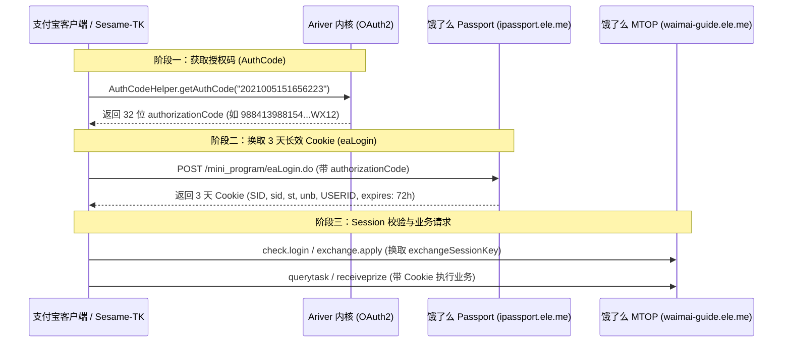
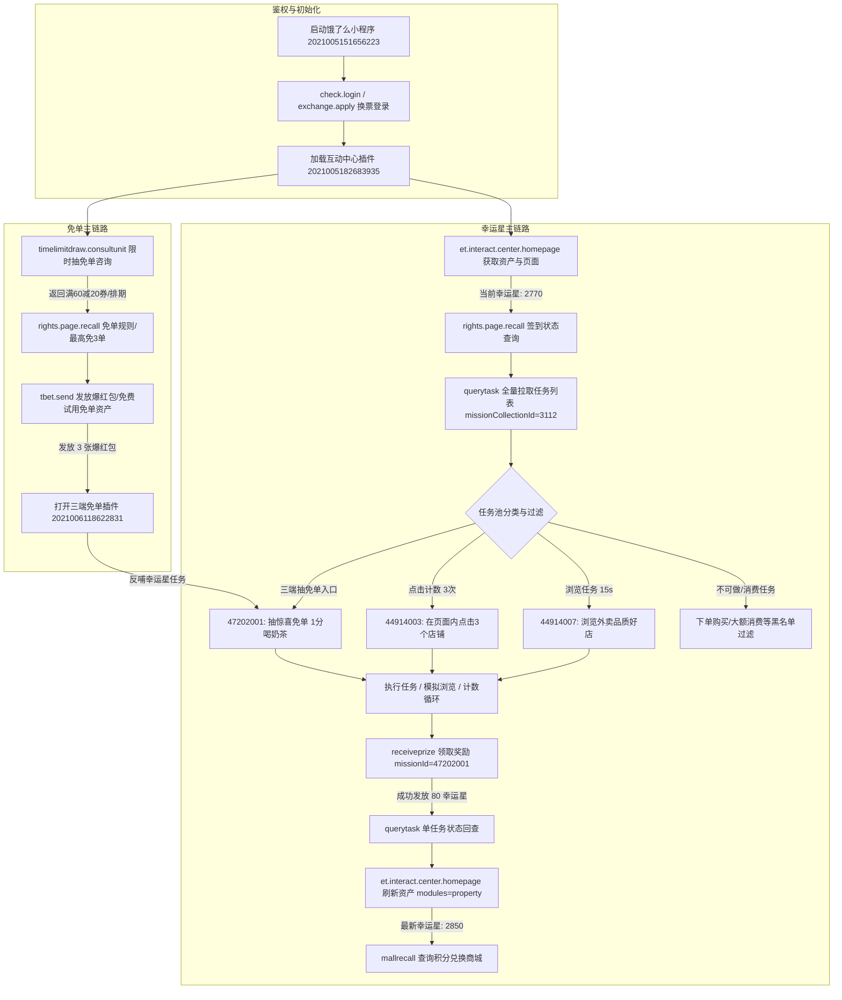

# 饿了么「幸运星」与「免单」流量与接口全景深度分析报告

> **数据来源**: `scratch/tb.log`（共计 1,785 条捕获记录，总大小 6.54 MB）  
> **抓包场景**: 饿了么外卖支付宝小程序（AppId: `2021005151656223`）  
> **核心业务**:
> 1. **幸运星模块**（签到、任务拉取、任务执行、领取奖励、资产更新、积分商城兑换）  
> 2. **免单模块**（签到、限时抽免单、爆红包/免单资产发放、三端抽免单联动任务、免单卡规则）  
> **分析日期**: 2026-11-07  

---

## 一、抓包运行环境与底层通信协议

### 1.1 宿主与插件架构
从日志第 1~3 行可知，用户在支付宝 Android 客户端中启动了饿了么外卖核心小程序，并通过 Ariver/XRiver 内核加载对应独立业务插件：

* **宿主小程序 AppId**: `2021005151656223`（饿了么外卖小程序）
* **客户端版本**: `AlipayClient/12.12.30.8000`, Android 16 (vivo V2238A)
* **业务插件加载**:
  * `pluginId=2021005182683935`: 饿了么权益中心 / 互动中心插件（`ET_RIGHTS_CENTER`），承载**幸运星**业务
  * `pluginId=2021006118622831`: 饿了么三端抽免单插件（`et-miandan-site`），承载**免单**业务
* **用户身份体系**:
  * 饿了么用户 ID (`ELE_USER_ID`): `1000059617824`
  * 阿里集团 Havana ID (`ALSC_HAVANA_ID`): `2207586036214`
  * 支付宝账号 ID (`user_id`): `2088232515543121`
  * 账户方案: `HAVANA_COMMON`，登录状态由 `mtop.alsc.user.session.ele.check.login` 与 `mtop.alsc.user.session.exchange.apply` 动态维护

### 1.2 网络协议通道与代理方式
日志中捕获的请求主要走 `MINI_HTTP` 代理通道：
```
com.alibaba.xriver.android.proxy.CRVRequestProxy#handleRequest  (发送请求)
com.alibaba.xriver.android.proxy.CRVRequestProxy#handleResponse (接收响应)
```
底层请求全部路由至 MTOP 网关：
* **网关地址**: `https://waimai-guide.ele.me/h5/{api}/{version}/`
* **AppKey**: `12574478`
* **JSV 版本**: `2.4.12`
* **ttid**: `2021005151656223@alipay_iphone_10.13.0` 或 `2021005151656223@alipay_android_12.1.53`
* **鉴权模式**: MTOP Token + WUA + 动态签名（Sign）

### 1.3 鉴权与 Token / Cookie 生命周期深度剖析

#### 1) 为什么“第二天重放请求依然正常”？
从日志第 124/145 行以及第 1043/1400 行提取到的真实凭据数据：
* **请求产生时间**: `1793873750000`
* **凭据过期时间 (`expires`)**: `1794132958000`
* **两者的差值**: `1794132958000 - 1793873750000 = 259,208,000 ms ≈ 72 小时 (整整 3 天)`！
饿了么 MiniApp 在登录完成后下发的核心 Cookie 集合（包括 `SID`、`sid`、`cookie2`、`st`）具备 **72 小时的超长生命周期**，在用户日常活跃期间甚至会不断顺延。因此，第二天（间隔 24 小时）重放完全在 72 小时有效期范围内，服务端校验 Session 依然完全合法有效。

#### 2) 三级 Token 获取与流转闭环



1. **第一级：支付宝授权码 (`authorizationCode`)**
   * 请求路由: 支付宝内部 Ariver OAuth2 服务
   * 代码支持: Sesame-TK 已自带 `fansirsqi.xposed.sesame.hook.internal.AuthCodeHelper.getAuthCode("2021005151656223")`，可在后台免界面无感换取。
2. **第二级：饿了么 Passport 会话换票 (`eaLogin.do`)**
   * **URL**: `POST https://ipassport.ele.me/mini_program/eaLogin.do?_bx-m=0.0.15`
   * **入参**: `appEntrance=alipay_sg&appId=2021005151656223&appName=eleme&authorizationCode={authCode}&type=alipay_mini_program`
   * **产物**: 下发包含 `SID`、`cookie2`、`st`（Session Token，如 `tb_s_ele_1hiv4...`）、`USERID` 的长效 Cookie 字典。
3. **第三级：业务网关会话映射 (`exchange.apply`)**
   * **API**: `mtop.alsc.user.session.exchange.apply`
   * 建立统一会话映射，返回 `exchangeSessionValue`。

#### 3) Sesame-TK 中的自动化 Token 维护方案
1. **自动感知与读取**: 优先直接通过 `android.webkit.CookieManager.getInstance().getCookie("https://waimai-guide.ele.me")` 读取系统中已有的饿了么 Cookie，只要用户此前在支付宝中打开过饿了么，便可直接复用。
2. **静默自愈刷新**: 当 MTOP 返回 `SESSION_EXPIRED` 或 `NOT_LOGIN` 时，触发 `AuthCodeHelper.getAuthCode()` -> 调用 `eaLogin.do` 换票刷新本地 Cookie 缓存，实现永远不掉线的后台自动化闭环。


---

## 二、业务全景架构与流程图

本次抓包完整记录了用户进入互动中心、完成签到咨询、拉取任务列表、执行做任务、领取 80 幸运星奖励、更新幸运星资产余额、以及抽免单/领红包的全流程：



---

## 三、核心 MTOP 接口全景清单

| 序号 | 接口名称 (API) | 请求方法 | 归属模块 | 核心功能 |
| :--- | :--- | :---: | :---: | :--- |
| 1 | `mtop.ele.biz.growth.task.core.querytask` | GET | 幸运星/任务 | 查询互动中心任务池列表、进度、动态密钥 `missionXId` |
| 2 | `mtop.ele.biz.growth.task.core.receiveprize` | GET | 幸运星/领奖 | 领取已完成任务的奖励（如 +80 幸运星） |
| 3 | `mtop.alsc.interact.et.interact.center.homepage` | GET | 幸运星/资产 | 互动中心主页配置、查询及刷新幸运星余额（`property`） |
| 4 | `mtop.ele.rights.page.recall` | GET/POST | 幸运星/免单 | 权益中心主页配置、签到状态、免单规则与入口配置 |
| 5 | `mtop.eleme.notify.subscribeRemindService.querySubscribeRemind` | GET | 幸运星/签到 | 幸运星签到订阅提醒（scene: `TaobaoFlashxyxqd`） |
| 6 | `mtop.alsc.interact.playapp.reward.right.mallrecall` | GET | 幸运星/商城 | 幸运星兑换商城（18888星兑18元饮品免单卡） |
| 7 | `mtop.alsc.upp.market.timelimitdraw.consultunit` | POST | 免单/抽奖 | 限时抽免单咨询与抽奖（排期、外卖秒杀券、免单红包） |
| 8 | `mtop.alsc.upp.tbet.send` | GET | 免单/权益 | 自动发放爆红包资产（EAT_PAID_COUPON_SEND，count: 3） |
| 9 | `mtop.alsc.eleme.miniapp.homepagev1` | POST | 外卖底座 | 外卖小时达主页流、地理位置反查 |
| 10 | `mtop.alsc.user.session.ele.check.login` | POST | 基础鉴权 | 饿了么用户 Session 登录校验 |
| 11 | `mtop.alsc.user.session.exchange.apply` | POST | 基础鉴权 | 支付宝与饿了么账号 Session 换票绑定 |

---

## 四、关键业务逻辑深度剖析

### 4.1 任务系统状态机（Task State Machine）
在 `mtop.ele.biz.growth.task.core` 体系中，任务有严谨的生命周期与状态标志位：
* `status`: 任务进行状态，取值有 `RUNNING`（进行中）、`FINISH`（已达成完成条件）。
* `rewardStatus`: 奖励领取状态，取值有 `TODO`（未完成/不可领）、`WAITING_RECEIVE`（待领奖）、`SUCCESS`（领奖成功）。
* `receiveStatus`: 奖励领取状态标志，取值有 `TORECEIVE`（待领取）、`HAVERECEIVED`（已领取）。

**状态流转路径**:
1. **未完成**: `status: RUNNING`, `rewardStatus: TODO`, `receiveStatus: TORECEIVE`
2. **任务完成**: `status: FINISH`, `rewardStatus: WAITING_RECEIVE`, `receiveStatus: TORECEIVE`, `finishStatus: 2`
3. **已领取**: `status: FINISH`, `rewardStatus: SUCCESS`, `receiveStatus: HAVERECEIVED`

### 4.2 任务类型与自动化可行性分类

根据日志数据与业务特征，任务池分为三大类：

#### 1) 浏览类任务 (PAGEVIEW) - ✅ 100% 可全自动完成
* **特征**: 配置 `actionType: "PAGEVIEW"`, `pageScene: "COMMON"`, `pageSpm: "a2ogi.bx1500380"`, 附带 `pageStageTime: "15"`（即浏览 15 秒）。
* **典型任务**:
  * `missionDefId: 44914007` (浏览外卖品质好店)
  * `missionDefId: 46230001` (逛一逛蚂蚁庄园)
  * `missionDefId: 47202001` (抽惊喜免单 / 玩法投放-三端抽免单新改版)
* **执行方案**: 模拟到达目标页面并驻留指定时间（15秒），或利用 SPM/页面进入打点通知服务端，服务端判定达标后状态置为 `FINISH`，随后调用 `receiveprize` 领奖。

#### 2) 点击计数类任务 (THIRD) - ✅ 循环计数 + 重刷列表自动化
* **特征**: 要求累计特定行为，例如 `missionDefId: 44914003` ("在页面内点击3个店铺")。
* **痛点与核心机制**:
  * 单次点击不会直接完成任务，而是增加内部计数（例如当前计数 1/3）。
  * **必须重新获取任务列表** (`querytask`)，此时服务端会更新当前的 `stage.count`、`missionXId` 以及阶段状态。
  * 客户端根据刷新后的任务状态，继续执行第 2 次、第 3 次，直至计数满足 3/3，任务状态流转为 `FINISH`，然后立即领奖。

#### 3) 不可做任务 (购买/大额消费类) - ❌ 必须严格黑名单阻断
* **特征**: 要求在饿了么外卖下单、大额支付、开通 SVIP 会员、购买 0.9 元付费爆红包券包等。
* **安全策略**: 模块必须维护关键词黑名单（如 "下单", "支付", "购买", "开通", "实付"），一旦匹配直接跳过，防止误操作或资金损失。

---

## 五、在 Sesame-TK 中的模块落地设计

本项目基于 `Sesame-TK` 的现有架构（`fansirsqi.xposed.sesame`），已经具备强大的 `MtopSender` 底层能力。可设计如下两个独立的后台任务模块：

1. **`ElemeLuckyStar` (饿了么幸运星模块)**
   * 对应包名: `fansirsqi.xposed.sesame.task.otherTask2.eleme`
   * 负责：每日签到 -> 拉取任务列表 -> 遍历并执行 PAGEVIEW/点击任务 -> 计数 3 任务循环拉取并执行 -> 逐一调用 `receiveprize` 领奖 -> 资产校验。
2. **`ElemeFreeOrder` (饿了么抽免单模块)**
   * 负责：每日签到 -> 触发 `timelimitdraw.consultunit` 抽免单/领外卖秒杀券 -> 触发 `tbet.send` 领取爆红包 -> 联动完成幸运星中的免单入口任务。

详细的接口协议、入参出参以及完整代码实现见后续专篇文档：
* [《饿了么_幸运星_接口与任务业务规范.md》](file:///D:/Desktop/py/wj_1/Sesame-TK-0.2.5-beta.6/doc/饿了么_幸运星_接口与任务业务规范.md)
* [《饿了么_免单_接口与抽免单业务规范.md》](file:///D:/Desktop/py/wj_1/Sesame-TK-0.2.5-beta.6/doc/饿了么_免单_接口与抽免单业务规范.md)
